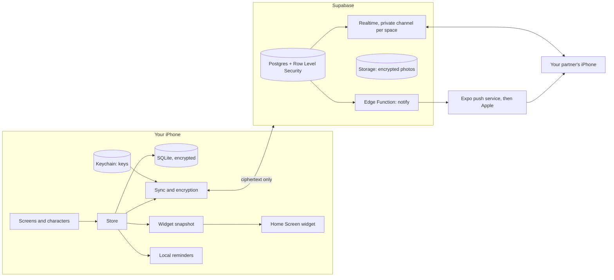

# Twodo architecture: the React Native app

**Status: proposed, 2026-11-17; phase 1 in progress.** Merging this doc approves the plan, and each phase in
section 10 then becomes its own PR. It turns the answers given on 2026-11-17 (framework, database, sign-in,
integrations, UI design) into one plan that Claude and Codex build from. It is also the separate write-up that roadmap
rule 13 asks for before any schema, storage or security change.

Until the new app ships, the web app keeps working exactly as it does now (Next.js on GitHub Pages, with Firebase).

## Decisions at a glance

| Area | Decision | What you get |
| --- | --- | --- |
| Framework | Rebuild as a **React Native** app with **Expo**, iPhone first | A real iPhone app: Home Screen widget, photos, native gestures and haptics. Built in the cloud, so no Mac is needed |
| Database | **Supabase** (Postgres, Realtime, Storage, Edge Functions), still end-to-end encrypted | Real SQL guarded by Row Level Security, encrypted photo storage, server functions for notifications |
| Sign-in | No preference was given, so: **email + password through Supabase Auth**. Your password never leaves the phone, and there's an optional Face ID lock | The sign-in you already know; the server still can't read anything |
| Integrations | **Photos in the journal and chat**, a **Home Screen widget**, plus reminders, notifications from your partner, the share sheet and calendar files | Pictures in posts and messages; Today on your Home Screen |
| UI design | **Playful, character-first**, on one design system | Characters that react on every screen, kept consistent by tokens, shared components and screenshot checks |



## What does not change

- **End-to-end encryption.** Everything you write is encrypted on the phone with the space key. Supabase stores
  ciphertext. It can see who is in a space, when something changed and how big it is, but never what it says. The same
  goes for photos.
- **Secret lists never leave the phone they are on.** They are never synced, exported, searched, counted, notified,
  put in the widget or included in a backup.
- **Everything coming in is validated before use**, whether from storage, the network, a notification or the widget.
  Today that is `cleanRecord` and `cleanMap`; the app uses the same rules, shared, written with zod.
- **Last write wins per record**, using the writer's update time, as today.
- **No analytics, ads, tracking or crash-reporting SDKs.** TestFlight's own crash reports and feedback are enough.
- **No secrets in the app or the repo.** The app carries only Supabase's publishable key. The secret key lives only in
  Edge Function secrets.
- The working rules stay: one topic per PR, tests in every PR, an iPhone checklist, and "Deiva" as the test partner.

## 1. Framework: React Native with Expo

**Why Expo.** Expo builds the iOS app in the cloud (EAS Build), so no Mac is needed. It also generates the native
projects from config (Continuous Native Generation), so there's no Xcode project to keep in sync: the widget target,
the App Group and encrypted SQLite are all switched on in `app.config.ts`. Its SDK covers almost everything Twodo
needs, which keeps third-party code to a minimum.

- **Versions today:** Expo SDK 58, React Native 0.88, React 19.3, iOS 16.4 or later. Phase 1 starts on whichever SDK is
  current then, and every SDK upgrade is its own PR.
- **New Architecture only.** Reanimated 4 requires it.
- **Development builds, not Expo Go.** Widgets, encrypted SQLite and the crypto module are native code.
- **iPhone first.** The same code runs on Android, but Android isn't built, tested or shipped until one of you needs it.
- **App ID:** `io.github.abilashsh.twodo` (it can't change once the app exists in App Store Connect).
- **Export compliance:** phase 1 has no encryption of its own, so `app.json` declares none. Phase 2 adds end-to-end
  encryption and must answer Apple's export compliance question again before its first build.

### Libraries (the whole list)

| Need | Library | Why this one |
| --- | --- | --- |
| Screens and navigation | Expo Router | File-based screens on a native stack. Links from notifications and the widget open the right screen |
| Animation and gestures | Reanimated 4, Gesture Handler | Animations and swipes run on the UI thread; only transform and opacity move |
| Characters and drawings | react-native-svg | The two characters are drawn in parts with soft gradients, so a mood can move just an arm or the head |
| Encryption | react-native-quick-crypto | Gives the WebCrypto API (AES-GCM, PBKDF2, HKDF, ECDH), so `crypto.ts` moves over with byte-identical formats |
| Data on the phone | expo-sqlite with SQLCipher | The phone's copy is encrypted; its key is in the Keychain |
| Keys and session | expo-secure-store | Keychain items that stay on this device |
| Cloud | @supabase/supabase-js | Uses the publishable key only |
| Validation | zod | Already used by the web app |
| Photos | expo-image-picker, expo-image-manipulator, expo-image | Pick, shrink and show photos |
| Notifications | expo-notifications | Local reminders and pushes from your partner |
| Widget | expo-widgets | Home Screen widget written in React, no Swift |
| Face ID | expo-local-authentication | The optional app lock and the secret lists |
| Haptics | expo-haptics | A tap you can feel for each moment |
| Launch | expo-splash-screen | The still splash in the launch colour, until the animated launch takes over |

Expo Router brings its own few (react-native-screens, react-native-safe-area-context, expo-linking, expo-constants).
For tests and previews only, never shipped: jest-expo, Testing Library, react-native-web.

Adding anything else needs a reason in its PR: what it does, who maintains it, and why nothing on this list can do it.

### On the phone

- **Store.** A small store read through `useSyncExternalStore`, with no state library, as today: memory first, saved to
  SQLite. Secret lists stay in their own vault and are in memory only while unlocked.
- **Sync engine**, about the size of today's `sync.ts`:
  - changes go into an outbox and are sent when there's a connection;
  - on start, the app asks for everything newer than the last server time it saw;
  - Realtime brings the rest live;
  - the newer update time wins.

  There's no sync framework: the data is small and encrypted, and a short engine we can read is easier to trust than a
  service in the middle.
- **Shared logic.** Pure TypeScript that both apps need moves to `shared/`: types, validators, dates, the week, the
  journal, character lines and the encryption formats. The web app imports it too until it's retired, so both read
  data the same way during the move.

### Repository layout

```
twodo/
  src/                  the web app, unchanged until it is retired
  shared/               pure TypeScript used by both apps
  mobile/               the Expo app (its own README and AGENTS.md)
    src/app/            screens (Expo Router); only screens live here
    src/ui/             the design system: tokens, theme, text, components, characters, launch
    src/data/           store, SQLite, sync, Supabase client, encryption (phase 2)
    src/features/       to-dos, week, journal, chat, photos, widget, notifications, vault, playground
    .eas/workflows/     build and send to TestFlight
    .maestro/           end-to-end flows
    app.json, eas.json
  supabase/
    migrations/         tables, Row Level Security, database functions (SQL)
    functions/          Edge Functions: notify, delete-account
    tests/              Row Level Security tests
```

### Build and release

- **Merging to `main` runs an EAS Workflow** that builds the iOS app and uploads it to TestFlight. Both phones update
  from the TestFlight app. The web app keeps deploying to GitHub Pages until it's retired.
- **Build allowance:** the free Expo plan includes up to 15 iOS builds a month in a slower queue, which is enough for a
  few releases a week.
- **Release at least every three months:** TestFlight builds expire after 90 days.
- **No over-the-air code updates (EAS Update) for now.** They're faster, but on the Free and Starter plans updates aren't
  end-to-end code-signed (that needs the $199-a-month Production plan), and an update runs with access to your keys.
  Every change ships as a full, Apple-signed build instead (open decision 5).

## 2. Database: Supabase

### What the server knows

It knows the same as Firebase does today:

- who has an account, and who is in which space;
- each record's key (`t:…` for a to-do, `j:…` for a journal page, `o:a`/`o:b` for each person's latest moment), its size, and when and by whom it changed;
- the public profile you use to find each other by @username: name, colour and public key.

It never knows a title, a message, a journal page, a photo or anything from a secret list.

### Tables

Every table has Row Level Security switched on and starts from "no access". Each policy opens exactly one thing.

| Table | Holds | Who can read and write |
| --- | --- | --- |
| `profiles` | id, @username (unique, 3–20 of `a-z 0-9 _ .`), name, colour, public key (ECDH P-256) | Read: anyone signed in (to find each other). Write: only your own row |
| `key_backups` | your private key and the space key, each encrypted with your password's wrap key | Only you |
| `spaces` | id (40 hex characters, as today) and the hash of the join token | Members read |
| `space_members` | space, user, slot `a` or `b` | Members read. Creating, joining and leaving a space only through database functions |
| `records` | space, key, `u` (update time on the phone), `d` (ciphertext, under 200,000 characters), who wrote it, server time | Members read and write. A write older than the stored `u` is ignored |
| `messages` | space, id, author slot, `u`, `d` (under 30,000 characters) | Members read and add; only the author edits or unsends |
| `chat_reads` | how far each person has read (`d` encrypted) | Members read; you write only your own |
| `reactions` | one tapback per person per message (`d` encrypted) | Members read; you write only your own |
| `requests` | partner requests: from, to, and the request (name, colour, public key, wrapped space key) | The sender and the recipient |
| `push_tokens` | a device's push token | Only you |

The encrypted `d` is exactly today's format (base64 of IV + AES-GCM ciphertext), so the move can copy it unchanged.

### Joining a space without pairing again

Today a Firebase invite lets your partner add themselves to your space. In Supabase a **join token** does it:

1. The phone derives the token from the space key:
   `HKDF-SHA256(space key, salt = space id, info = "twodo/join/v1")`.
2. When a space is created, the server stores only the token's SHA-256 hash.
3. `join_space(space, token, slot)`, a database function, adds the caller if the hash matches and the slot is free. A
   space never has more than two members.

Only phones that hold the space key can make the token. Pairing (the @username request and the safety code, as today)
still decides who gets the key; the token only proves it to the server. It also lets the two of you move to the new
app without pairing again (section 7). The token can't be turned back into the space key, and even a stranger who
somehow joined would only get ciphertext.

### Live updates

- **How:** a database trigger sends each change by **Realtime Broadcast on a private channel per space**
  (`space:<id>`).
- **Who:** only members can join that channel (a policy on `realtime.messages`). Public channels are switched off for
  the project.
- **Typing and "online"** go over the same channel and are never stored.
- **Not Postgres Changes.** It's simpler, but Supabase recommends Broadcast for security and scale, and Postgres Changes
  doesn't filter deleted rows by Row Level Security.

### Photos

Photos go in a private bucket, `photos`, with one folder per space: `<space id>/<random id>`. Only members of that
space can read, add or delete there. Every file is ciphertext (section 4.1), and the bucket accepts files up to 5 MB.

### Free plan limits (checked 2026-11-17)

| Limit | Free plan | What it means for us |
| --- | --- | --- |
| Database | 500 MB | Years of to-dos, posts and messages; text is small |
| File storage | 1 GB | About 3,000 photos at about 300 KB each, thumbnail included |
| Egress | 5 GB a month, plus 5 GB cached | Each phone downloads a photo once and keeps it |
| Monthly active users | 50,000 | Two |
| Pausing | Paused after a week of too little activity | Daily use keeps it awake. If neither of you opens the app for a week, it pauses (nothing is lost) and is restored from the dashboard |
| Backups | None you can download | The app's own backup export stays (never with secret lists). Pro, $25 a month, adds daily backups and never pauses |

### Proposed: bind each ciphertext to its place (format v2)

Today a record's ciphertext isn't tied to its key, so a server could swap the encrypted contents of two records without
anyone noticing.

- New writes from the app add the space id and the record key as AES-GCM additional data
  (`twodo/rec/v2|<space>|<key>`).
- Messages and photos are bound the same way, with their own ids.
- A v2 ciphertext starts with `v2.`, and readers accept both formats, so nothing written before breaks.

This is the only change to the encryption itself.

## 3. Sign-in: Supabase Auth, email and password

You had no preference, so sign-in stays as it is today and moves to Supabase.

- **Your password never leaves the phone.** It goes through PBKDF2 (600,000 rounds), as today:
  - one half becomes the login secret that Supabase checks;
  - the other half becomes the wrap key that opens your private key and space key from `key_backups`.

  A new phone gets your keys back from your password alone.
- **Forgotten password:** as today, the server can't reset it, because your password is your key. The way back is a new
  account and pairing again.
- **Session:** Supabase's tokens are saved encrypted (AES-GCM), with the key in the Keychain on this device only.
- **Keys:** your private key, the space key and the vault key are Keychain items. They can be read only while the phone is
  unlocked, and they never go into iCloud backups or onto other devices.
- **Optional Face ID lock** for the whole app, in Settings, on top of the phone's own lock.
- **Secret lists** keep their 6-digit passcode. Face ID for them becomes a Keychain item that opens only after Face ID,
  instead of today's passkey.
- **Sign-ups switched off** once you both have accounts. The app is for two people, so nobody else can even create an
  account. Switch sign-ups back on in the dashboard if one of you ever needs a new account.
- **Delete account** in Settings, through an Edge Function. It removes your account and your rows, plus the space's
  photos if you're alone in it.

## 4. Integrations

### 4.1 Photos in the journal and chat

1. **Pick or take.** Use the system photo picker, which doesn't give the app your whole library, or the camera (the app
   asks the first time). Up to 4 photos per journal page or message.
2. **Shrink on the phone.** The photo is resized to 1,600 px on its long side, with a 400 px thumbnail, both re-encoded
   as JPEG. Re-encoding also drops location and other metadata; a test checks this.
3. **Encrypt on the phone** with the space key, a random IV for every file, and the space id and file id bound as
   additional data.
4. **Upload** the photo and its thumbnail to `photos/<space>/<random id>`.
5. **Reference it.** The page or message carries only `{ id, w, h }` for each photo, inside its ciphertext. Your
   partner's phone downloads, decrypts and keeps the photo in the app's protected files.

Removing a photo from today's page or unsending a message deletes its photos. Only your phones can read which photos
are still in use, so the app tidies up leftovers (files no page or message points to), not the server.

### 4.2 Home Screen widget

The widget is built with expo-widgets (in React, no Swift). It reads a small snapshot that the app writes whenever Today
changes. It never reaches the network and never holds a key.

| Size | Shows |
| --- | --- |
| Small | Your character, how many to-dos are left today, and the next one |
| Medium | Both characters and up to four of today's to-dos with their times |
| Lock Screen | "3 left today": a count, no titles |

- **Never in the widget:** anything from a secret list, chat or journal text, or photos.
- **When the phone is locked, titles are hidden.** If expo-widgets can't redact them, the Home Screen widget shows
  counts only until it can.
- **Tapping a to-do** opens the app on it.
- **Ticking from the widget comes later.** The app would have to sync the tick afterwards, so it's not in the first
  version.

### 4.3 Reminders and notifications

- **Reminders are scheduled on the phone** as local notifications.
  - Every to-do with a date and time meant for you gets one, including ones your partner set, once your phone has
    synced them.
  - iOS allows 64 waiting notifications per app, so the app keeps the 64 soonest and tops them up on every open and
    sync.
  - The title never leaves your phone.
  - This replaces the GitHub Action that sends web pushes every five minutes.
- **Notifications from your partner** ("Deiva sent you a message", "Deiva wrote today's page", "Deiva loved your
  page"):
  - a database webhook calls the `notify` Edge Function, which sends a push through Expo's push service;
  - the push says only who and what kind, never the content, and tapping it opens the right screen;
  - it also nudges the phone to sync, which picks up new reminders;
  - previews that show the message itself would need decrypting on the phone in a notification extension: possible
    later (open decision 6).
- **Secret lists never notify.**

### 4.4 Kept from today

- The share sheet, to share a to-do or a list as text.
- Calendar files (.ics) through the share sheet, so the app never needs calendar permission.
- Haptics on every moment.
- The backup export, never with secret lists.

### 4.5 Gone with the web app

The service worker, Web Push with VAPID keys, the reminders GitHub Action, the content security policy and GitHub Pages
hosting. Their rules move to section 6.

## 5. UI design: playful, character-first

Two original characters, female and male, drawn in a soft 3D style (big eyes, rounded shapes, light from the top left).
Each of you picks a look, a skin tone and a hair colour, and your character wears your colour. They are the heart of
every screen: they greet, cheer, react and keep each other company. One design system keeps it consistent and fast.
(Chosen 2026-11-18 from the owner's reference of a 3D avatar app; they replace the six blob characters.)

### Principles

1. **Every screen has a host.** One character (two on Home and in the journal) leads each screen. It's the first thing
   you see, and it reacts to what you do there.
2. **Reactions are earned.** A character reacts to something that happened (a tick, a post, a heart, a message), never on
   a timer. Each character reacts at most once every few seconds, so it never gets noisy.
3. **Your two colours carry everything.** Your colour is you and your partner's is them; nothing else uses them.
4. **Calm text, playful frame.** Text stays plain and readable. The play is in the characters, the motion and the
   haptics.
5. **Fast first.** A reaction never delays what you tapped: the to-do ticks in the same frame and the character follows.

### Moments

| Screen | Host | Moments |
| --- | --- | --- |
| Launch | Two hearts | The two hearts meet: "Two souls, one space." A still splash first, then the animation inside the app |
| Home | Both of you | A fanned stack of cards (today's to-dos, your partner, the journal, the week): swipe the top one away or tap a dot to bring another up. Each card's characters react when it comes to the top (your partner's waves). Cards show counts and nudges, never a message's or a page's text |
| Today and To-dos | Yours | A small hop on each tick; when the day is done, both characters celebrate |
| This week | Yours | Sits on the day you're looking at; a busy day gets a gentle "phew" |
| Journal | Both, on a stage above the day's page | Yours thinks while today's page is empty and smiles when you save it; giving a heart to your partner's page makes yours love it. Tap either to wave |
| Chat | Your partner's, in the header | Thinks while they type; hearts when "I love you" is sent; dozes when they've been away for a while |
| Empty states | Yours | A friendly line and one clear thing to do |
| Offline or error | Yours | Holds an umbrella: "Saved on your phone; it'll sync when you're back online" |
| Settings | Yours | Pick a character and a role; the preview reacts as you choose |

### Characters

- They're drawn in react-native-svg, split into parts (back hair, legs, hoodie, head, arms, shadow) so a mood can move
  one part. Each surface has a light-to-shade gradient, with highlights on the hair and eyes and soft shadows under
  the fringe, the chin and the feet. Six skin tones and five hair colours; the hoodie is the person's colour.
- **True 3D renders** (like the reference) would need a 3D artist or rendered images. The component's API stays the
  same, so drawings could be swapped for images later without touching any screen.
- **Moods:** idle, happy, wave, hop, cheer, love, think and sleepy. Each is a short animation built from the motion
  tokens.
- **One component,** `<Avatar avatar color state moment size />`, draws them all (`<Portrait>` for head and
  shoulders in a circle). Screens ask for a mood, and a small controller
  decides whether it plays (cool-down, Reduce Motion, app in the background).
- **In long lists** (the journal, the week) characters stay still; only the host moves.

### Tokens (one file: `mobile/src/ui/tokens.ts`)

- **Colour:** the same 12 named colours as today, each with light and dark values, plus the neutrals. Text on any colour
  keeps 4.5:1 contrast, tested for all 12 colours in light and dark.
- **Type:** the system font for reading text, so Dynamic Type works, and the iPhone's own rounded face (`ui-rounded`,
  the same as the web app) for titles and big moments: nothing to bundle or load.
- **Space** on a 4-point grid, **corners** in four radii, **shadows** in three levels.
- **Motion:** three springs (gentle, bouncy, snappy) and three durations. Reduce Motion swaps them for short fades.
- **Haptics:** light for a tick, soft for a heart, success when the day is done, warning before a delete.

### Components

Screen, LargeTitle, Card, Row, Button (primary, quiet, danger), PillButton (a washed call to action), BackButton, Chip,
Badge, Sheet, Composer, TodoRow, MessageBubble, PhotoGrid, Avatar, Portrait, Stage (two characters), PillBar (the tab
bar), CardStack (Home's fan), the journal's day strip and calendar, EmptyState and Toast.

Screens are built only from these components and the tokens. A lint rule rejects raw colours and sizes outside
`src/ui`.

### Navigation

Four tabs, Home, To-dos, Journal and Chat, switched from a floating dark pill near the bottom (after the owner's
reference); the chosen tab is a light circle. Screens leave room for it. The Playground, where you change how you both
look, opens on top of the tabs from your picture on Home.

### Accessibility

- VoiceOver labels on everything you can tap. Characters are decorative unless they're a button (your partner's opens
  the chat).
- Dynamic Type up to a cap that keeps layouts intact, and tap targets of at least 44 pt.
- Reduce Motion is respected, and nothing important depends on animation or colour alone.

### Keeping it stable

- A hidden **Playground** screen, in development builds only, shows every component and every mood in light and dark.
- End-to-end tests screenshot the Playground and the main screens, so a PR that changes them shows the pictures for
  review.
- `design.md` gains an "App" section in phase 1 and stays the one visual specification for both apps.

## 6. Security rules for the app (every PR)

Once the app exists, these replace the web-only rules in `AGENTS.md` (the content security policy, no inline scripts).

1. **Row Level Security on every table and on the storage bucket.** Every policy has a test that a stranger, and a member
   of another space, can't read or write (`supabase/tests`).
2. **Only the publishable key ships in the app.** `EXPO_PUBLIC_*` values are public by design. The secret key lives only
   in Edge Function secrets: never in the repo, `app.config.ts`, `eas.json` or a chat.
3. **Validate everything that comes in**, whether from Supabase, SQLite, a notification, a deep link or the widget
   snapshot.
4. **User text is only ever rendered as text:** no WebView, no HTML, no `eval`.
5. **Secret lists** are never synced, exported, searched, counted, notified or put in the widget; tests check each one.
6. **Keys live only in the Keychain** (this device, while unlocked), and nothing secret goes into logs.
7. **No new third-party service or SDK** without first writing down what it can see.
8. **Accounts use 2FA:** Apple, Expo, Supabase and GitHub. Signing credentials live in EAS, and the App Store Connect API
   key lives only in EAS secrets.
9. **Dependencies are pinned,** with `npm audit` in CI and Dependabot on.
10. **A schema, storage or security change is written down** here, or in a doc next to this one, before it's built.

## 7. Moving from the web app

Each of you moves once, on your own phone, and nothing is decrypted anywhere but on the phone.

1. Install the app from TestFlight and sign in with the same email and password.
2. The app signs in to Firebase once, with the same login secret as the web app. It fetches your encrypted key backup and
   opens it with your password, so you have the same keys and space key as before.
3. It creates your Supabase account (same login secret) and stores the same encrypted key backup.
4. **The first of you to move** creates the space in Supabase with the same id, then copies every record and message
   unchanged. Each one is decrypted and checked on the phone first, but what's uploaded is the original ciphertext.
   Message authors become slots (`a` or `b`) instead of Firebase ids.
5. **The second of you** joins with the join token (section 2): no new pairing, no safety code again.
6. Reminders are scheduled again from the to-dos. Chat reactions and read receipts come along; typing doesn't.
7. Once you've both moved, the web app shows "Twodo moved to the app" and stops writing. The Firebase data is deleted
   once you've checked everything (open decision 3).

**Secret lists can't come along on their own.** By design they never leave the phone they're on, and the new app can't
reach the web app's storage. Re-create them by hand (recommended), or decide on a one-time transfer (open decision 1).

**The journal by day (decided 2026-11-18, before building, as roadmap rule 13 asks).**
- One page per person per day, kept as `journal` records with ids `us-<date>-<who>` (the web app's format before the
  thread), so only its writer ever edits a page and two phones never write the same record.
- Only today's page can be written: the app refuses any other date, and earlier days are read-only. "Today" is the
  phone's own calendar day; words typed just before midnight stay in the box and save to the new day.
- Posts from the web app's thread (`us-p…`) show under the day they were written, read-only.
- Hearts stay: one per person per page, only on your partner's page.
- Characters: each person's look, skin tone and hair colour are stored with the person, like name and colour. The web
  app's six characters (`char`) map to a default look during the move.

## 8. Testing

| Level | What | Where it runs |
| --- | --- | --- |
| Logic | Jest unit tests for `shared/` and the app's data layer: validators, dates, the week, the journal, character lines. Today only browser tests cover these, so the unit tests are new | GitHub Actions |
| Encryption | Test vectors: a record encrypted by the web app decrypts in the app and back; v2 additional data; the join token | GitHub Actions |
| Database | Row Level Security tests for every table and the bucket | A local Supabase (`supabase start`, in Docker) on GitHub Actions |
| Two phones | Two app clients against the local Supabase: sync, live updates, hearts, messages, last write wins, joining | GitHub Actions |
| Screens | Maestro flows on an iOS simulator: sign in, add and tick a to-do, the week, today's journal page and a heart, a message with a photo, the vault. Screenshots in light and dark | EAS Workflows (its Maestro job is in alpha), or a macOS runner on GitHub Actions |
| iPhone | The checklist in each PR, on your phones through TestFlight | You |

The web app's test suite keeps running until the web app is retired.

## 9. What it costs

| Item | Cost | Needed for |
| --- | --- | --- |
| Apple Developer Program | 99 USD a year, or the local price | TestFlight: the way to put the app on both of your iPhones and keep it updated |
| Expo (EAS) | Free: up to 15 iOS builds a month, slower queue | Cloud builds and TestFlight uploads. Starter ($19 a month) mainly buys a faster queue |
| Supabase | Free | Database, sign-in, live updates, photos, functions. Pro ($25 a month) if pausing or backups start to matter |
| GitHub | Free | Code, tests, and the web app until it's retired |

The minimum is the Apple membership. Today's web app costs nothing, and that's the trade for a real app.

## 10. Delivery plan

Each phase is one or more PRs to `main`, merged in order. The web app keeps working throughout.

| Phase | Builds | You'll see |
| --- | --- | --- |
| 1. Foundations | The Expo app with the tokens, the components, the characters and their moods, the launch and the Playground; checks on every PR; builds to TestFlight. Then the Supabase schema with Row Level Security and its tests | A TestFlight build with the launch, the characters and the Playground |
| 2. Data | `shared/` extracted (web app unchanged); encryption ported with test vectors; the SQLite store, sync and Realtime; sign-up, sign-in, pairing, the join token | Sign in and pair in the app (test accounts) |
| 3. Screens | Home, Today and To-dos, the week, the journal by day (one page each, only today written) and hearts, chat, Settings, the vault (Home and the journal exist as designs with sample data since 2026-11-18) | The whole app working on test accounts |
| 4. Integrations | Reminders and notifications from your partner, photos in the journal and chat, the widget | Photos, notifications and the widget |
| 5. The move | The move from Firebase, the "moved" banner in the web app, account deletion | Both of you on the app, with your real data |
| 6. Retire the web app | The web app goes read-only, then is removed with Firebase and the reminders action (open decision 3) | One app |

Before the first build can reach your phones, three accounts are needed:

- the Apple Developer Program;
- an Expo account (free, with 2FA);
- a Supabase project (free, with 2FA).

Your partner also needs adding as a TestFlight tester. The first build is set up once from a computer
(`mobile/README.md`, "First build"); after that, every merge that changes the app arrives in TestFlight by itself.

## 11. Open decisions

| # | Question | Recommended | Other option |
| --- | --- | --- | --- |
| 1 | Secret lists in the move | Re-create them by hand in the app | A one-time transfer protected by a fresh code (a security change to write down first) |
| 2 | The name under the app icon (iOS needs one) | "Twodo" for now | Any name you choose |
| 3 | The web app and the Firebase data after the move | Read-only for 30 days, then removed | Keep the web app as a read-only backup |
| 4 | Supabase plan | Free to start | Pro, $25 a month: never pauses, daily backups |
| 5 | Over-the-air updates | Off: every change is an Apple-signed TestFlight build | EAS Update for faster fixes, but only with code signing |
| 6 | Notification previews | "Deiva sent you a message", with no content | Previews decrypted on the phone by a notification extension |
| 7 | Android | Not now | Build and test it if one of you needs it |

## 12. Sources (checked 2026-11-17)

- Expo: [SDK versions](https://docs.expo.dev/versions/latest/) · [Widgets](https://docs.expo.dev/versions/latest/sdk/widgets/) · [Widgets stable in SDK 56](https://expo.dev/blog/ios-widgets-and-live-activities-in-expo) · [SQLite and SQLCipher](https://docs.expo.dev/versions/latest/sdk/sqlite/) · [Using Supabase](https://docs.expo.dev/guides/using-supabase/) · [Maestro on EAS Workflows](https://docs.expo.dev/eas/workflows/examples/e2e-tests/) · [Pricing](https://expo.dev/pricing)
- Supabase: [Pricing](https://supabase.com/pricing) · [Free project pausing](https://supabase.com/kb/faqs/platform/free-project-pausing) · [Production checklist (backups)](https://supabase.com/docs/guides/deployment/going-into-prod) · [API keys](https://supabase.com/docs/guides/getting-started/api-keys) · [Subscribing to database changes](https://supabase.com/docs/guides/realtime/subscribing-to-database-changes) · [Realtime authorization](https://supabase.com/docs/guides/realtime/authorization) · [Realtime troubleshooting (deletes and RLS)](https://supabase.com/docs/guides/troubleshooting/realtime-messages-not-arriving)
- Libraries: [react-native-quick-crypto coverage](https://crypto.margelo.com/docs/introduction/coverage) · [Reanimated 4](https://docs.swmansion.com/react-native-reanimated/docs/fundamentals/getting-started)
- Apple: [Developer Program fee](https://developer.apple.com/programs/enroll/) · [TestFlight](https://developer.apple.com/testflight/) · [Internal testers, 90 days](https://developer.apple.com/help/app-store-connect/test-a-beta-version/add-internal-testers/) · [64 pending local notifications](https://developer.apple.com/forums/thread/811171)
