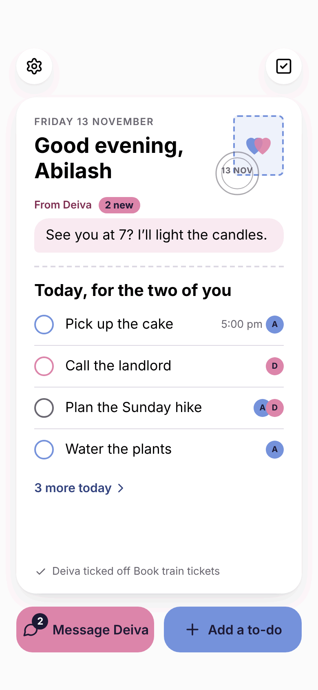
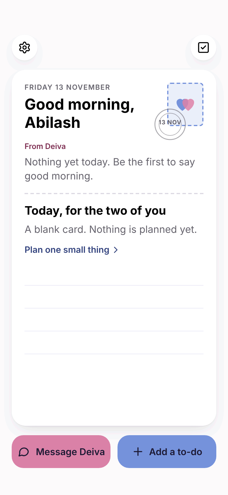
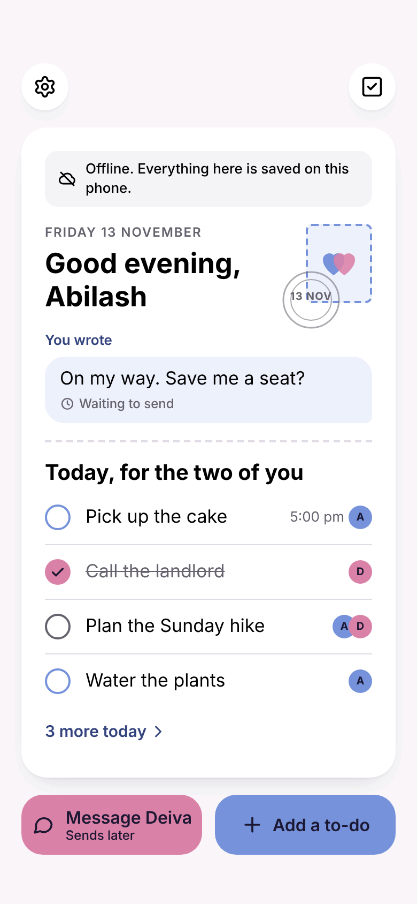
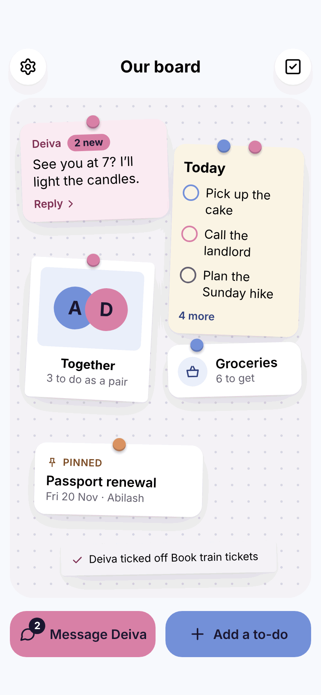
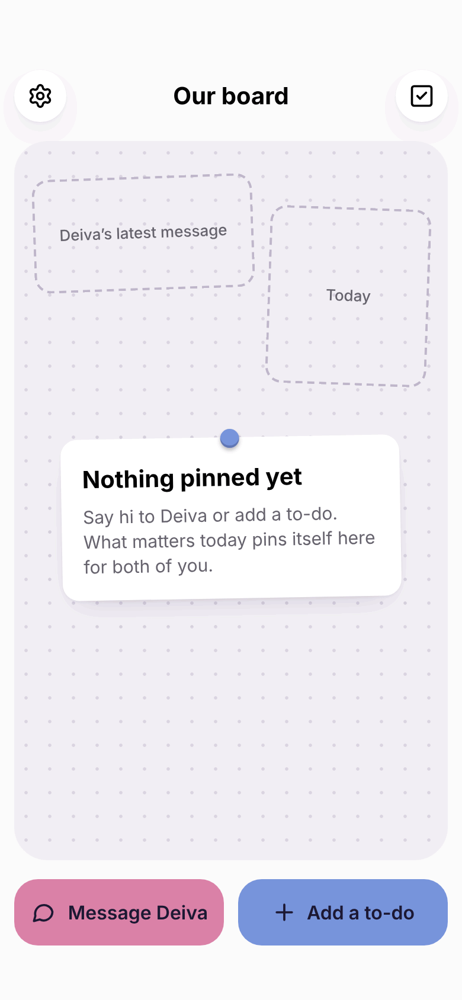
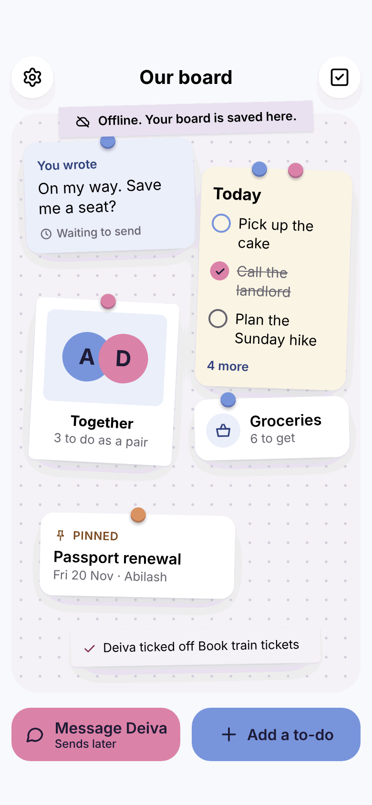
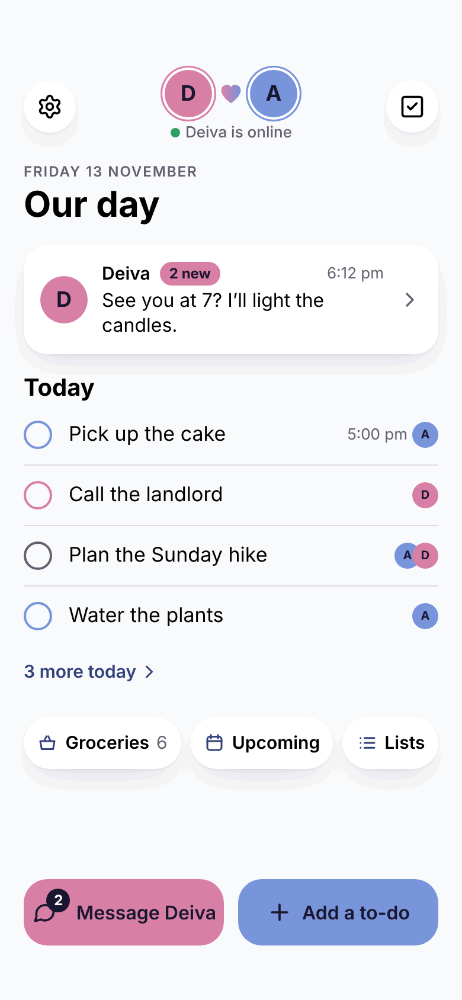
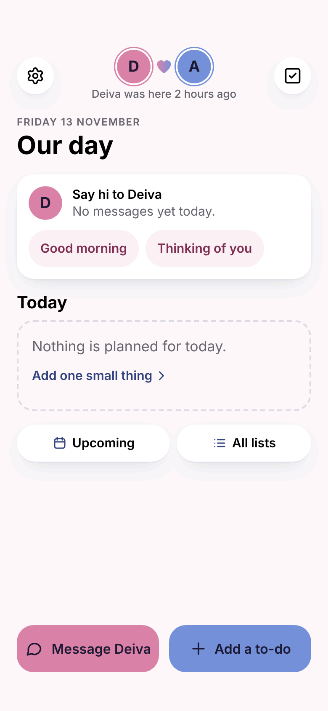
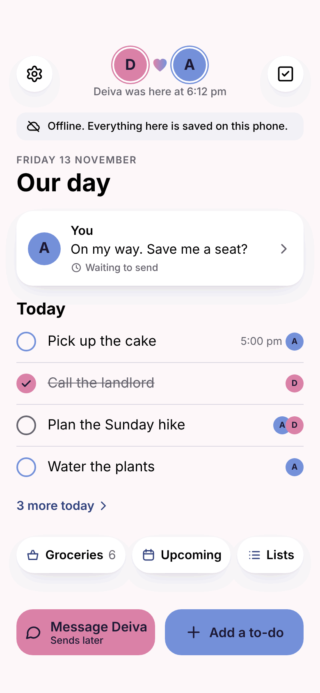

# Home screen: three concepts

Roadmap item 2. The home screen is not decided. These are three different directions to react to, drawn as phone
mockups (390 × 844, light theme) with fictional data: Abilash in blue, Deiva in pink, an ordinary Friday.
Nothing here is built into the app yet.

What every concept keeps the same, so they can be compared fairly:

- **Two actions at the bottom, in thumb reach:** *Message Deiva* (in her colour, with the unread count) and
  *Add a to-do* (in yours). They never move.
- **Settings** top left, **all to-dos and lists** top right, as today.
- **Whose is it** is shown by colour and initial: blue ring and "A", pink ring and "D", both overlapping for the two
  of you.
- **Nothing from a secret list** appears: no content, no titles, no counts.
- **One change they all share:** today the app opens straight into the chat. With any of these, the chat becomes a
  screen you open with one tap and swipe back from. Each concept shows the latest message on Home to make up for it.

## 1 · Postcard

A single card for the day, like a postcard the two of you share: a greeting, the date as a postmark, the latest
line from your partner, and today's to-dos.

 

- **Navigation.** Home is the card and it does not scroll. The message on the card and *Message Deiva* open the
  chat. *3 more today* opens Today. Checkboxes tick in place. Back always returns to the card.
- **Before scrolling.** Everything: greeting and date, the latest message, up to four of today's to-dos, what your
  partner last ticked off, and the two actions.
- **One hand.** Both actions at the bottom. The to-dos sit mid-screen, reachable on most phones.
- **Empty.** "A blank card": an invitation to say good morning and to plan one small thing.
- **Offline.** A notice at the top of the card; your unsent message shows "Waiting to send"; ticking still works.
- **Good.** The most personal of the three, and calm: one glance, no scrolling, room for a character or a daily
  touch on the stamp.
- **Costs.** It shows the least. The fixed card must be designed for small phones and long names. A greeting that
  never changes will feel stale, so it needs a little daily variety.

## 2 · Pinboard

A shared board with a few notes pinned to it. The pin shows who it belongs to.

 

- **Navigation.** The notes are the doors: the message note opens the chat, *Today* opens Today, *Together* opens
  your shared to-dos, *Groceries* opens that list, the pinned note opens that to-do. The two actions stay in the
  tray at the bottom.
- **Before scrolling.** Up to six notes in fixed places (latest message, Today, Together, one list, one pinned
  to-do, the last thing ticked off) and the tray. The board fills itself from what already exists (the `pinned`
  flag, today's to-dos, the last message), so it needs no new stored data.
- **One hand.** The tray is easy. The top notes are a stretch on a large phone.
- **Empty.** A bare board with one note explaining that things pin themselves here, and outlines where they will go.
- **Offline.** A strip of tape across the top; your unsent message shows "Waiting to send".
- **Good.** The most playful and the most "ours". Whose-is-whose is visible at a glance.
- **Costs.** The most work and the most risk. Tilted, overlapping notes are harder to read, harder for VoiceOver
  and for large text, and to-do titles wrap in narrow notes. Letting people arrange the board themselves would need
  new synced data (a separate proposal). It is the easiest to make cluttered.

## 3 · Our day

A short page: who is here, the latest message, today's to-dos, three shortcuts.

 

- **Navigation.** The message card and *Message Deiva* open the chat. To-dos tick in place; *3 more today* opens
  Today. The shortcuts open a list, Upcoming and all lists. Back always returns here.
- **Before scrolling.** The two of you and whether your partner is online, the latest message, up to four of
  today's to-dos, three shortcuts, and the two actions. The page only scrolls on very small phones.
- **One hand.** Everything you act on is in the lower two thirds.
- **Empty.** "Say hi to Deiva" with two one-tap openers, and "Nothing is planned for today" with one link.
- **Offline.** One quiet notice under the header; your unsent message shows "Waiting to send"; ticking still works.
- **Good.** The most useful per glance, and the closest to how the app already works, so the least risk. It grows
  naturally on a tablet (chat beside the day). The header has room for the two characters.
- **Costs.** The least surprising to look at. It can drift into a dashboard if things keep being added, so it has
  hard limits: one message card, four to-dos, three shortcuts, no numbers except what is left to do.

## Side by side

| | Postcard | Pinboard | Our day |
| --- | --- | --- | --- |
| Feels personal and playful | High | Highest | Medium |
| Useful at a glance | Medium | Medium | Highest |
| Open the chat | 1 tap | 1 tap | 1 tap |
| Add a to-do | 1 tap | 1 tap | 1 tap |
| Tick a to-do from Home | Yes | Yes (small targets) | Yes |
| One-handed use | Good | Fair | Best |
| Large text and VoiceOver | Good | Hardest | Good |
| Work to build | Medium | Highest | Lowest |
| Risk to navigation and gestures | Low | Medium | Lowest |
| Needs new stored data | No | No (yes, if people arrange it) | No |

## Recommendation: Our day

It serves the two things done most (reading the latest message, ticking and adding to-dos) in one glance, changes
the navigation the least, and is the safest to keep reliable with the keyboard, offline and on other screen sizes.

It is also the plainest of the three, so I would borrow from the others rather than choose them:

- the postcard's greeting and date mark, as the top of the page;
- the pinboard's pins, as the mark on a pinned to-do;
- the two characters (roadmap Phase 5) in the header, beside the names.

If personality matters more to you than glanceable usefulness, choose the Postcard: it is nearly as safe to build.
I would not start with the Pinboard; it could become a second view later.

## What is needed to go on

One answer: **Postcard, Pinboard, Our day, or a mix** (for example "Our day with the postcard greeting").
Roadmap Phase 3 starts from that answer. Until then nothing about Home or its navigation changes.

Not drawn yet, and following from the choice: the dark theme, tablet and desktop layouts, the state before a
partner is connected (the message area becomes "Add your partner"), and the motion between Home and the chat.

## Files

- `home-concepts/*.png`: the nine screens.
- `home-concepts/mockups.html`: all nine on one page (open it in a browser).
- `home-concepts/build-mockups.py`: generates the HTML (`python3 build-mockups.py standalone <folder>`). Colours,
  type and shapes follow `design.md`. The Settings and To-dos icons are the ones the app already uses
  (lucide-react, ISC licence); every other drawing is original to these mockups.
